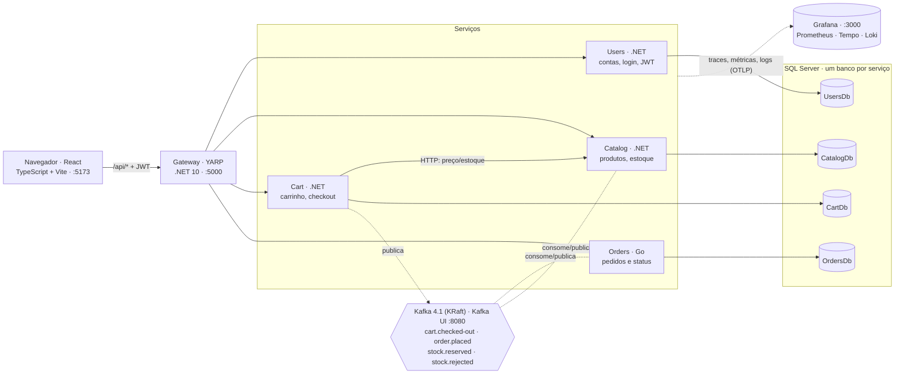
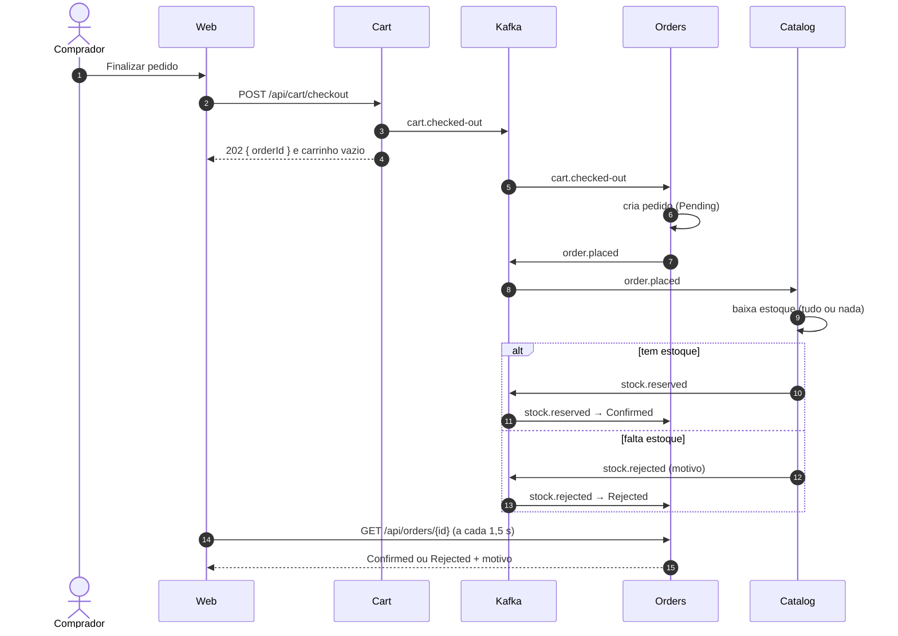

# Marketplace

Marketplace multi-vendedor em microsserviços: **.NET 10**, **Go**, **React + TypeScript**, **SQL Server**,
**Kafka**, **YARP**, **Docker**. Desenvolvido com TDD e de forma incremental com apoio de IA (ver [`.ai/`](.ai/README.md)).

Qualquer conta compra e pode ativar o perfil de vendedor ("Começar a vender"). Quatro microsserviços, cada um com
seu banco, um gateway na frente e o Kafka levando os fatos de um serviço para o outro.

## Arquitetura



Ninguém lê o banco de outro serviço. O que um serviço precisa saber de outro chega por HTTP (quando a resposta é
necessária na hora) ou por evento. Detalhes em [`.ai/context/architecture.md`](.ai/context/architecture.md).

### Serviços

| Serviço | Stack | Responsabilidade | Rotas (via gateway) | Porta local |
|---|---|---|---|---|
| Gateway | .NET 10 + YARP | Porta de entrada única; roteia por recurso, CORS | `/api/*` · `/health/{serviço}` | 5000 |
| Users | .NET 10 + EF Core | Cadastro, login, emissão do JWT, ativar perfil de vendedor | `/api/users` · `/api/auth` | 5001 |
| Catalog | .NET 10 + EF Core | Produtos, preço, estoque; reserva o estoque dos pedidos | `/api/products` | 5002 |
| Cart | .NET 10 + EF Core | Carrinho por pessoa; checkout publica o evento do pedido | `/api/cart` | 5003 |
| Orders | Go 1.26 (stdlib) | Cria pedidos a partir do checkout e mantém o status | `/api/orders` | 5004 |
| Web | React 19 + TS + Vite | Vitrine, produto, carrinho, pedidos, conta, vender | — | 5173 |

### Fluxo de uma compra

O checkout responde na hora (`202 Accepted`) e o resto acontece por eventos. A tela do pedido consulta o status até
ele sair de *Processando*.



### Eventos

Envelope JSON `{ eventId, type, occurredAt, data }`, com os headers `event-type` e `event-id`. A chave da mensagem é
o id do agregado, o que mantém a ordem por pedido. Criação automática de tópicos desligada: todo tópico é declarado
no `docker-compose.yml`. Contratos em [`.ai/context/events.md`](.ai/context/events.md).

| Tópico | Produtor | Consumidor (grupo) | Chave | Conteúdo |
|---|---|---|---|---|
| `cart.checked-out` | Cart | `orders-service` | `cartId` | Itens com preço congelado no checkout |
| `order.placed` | Orders | `catalog-service` | `orderId` | Produtos e quantidades a reservar |
| `stock.reserved` | Catalog | `orders-service` | `orderId` | Estoque baixado para todos os itens |
| `stock.rejected` | Catalog | `orders-service` | `orderId` | Motivo legível e produtos sem estoque |

### Garantias

- **Pedido nunca duplica:** o id do checkout é calculado a partir do carrinho e da última alteração, e vira o id do
  pedido. Repetir o checkout ou reprocessar o evento cai no mesmo pedido.
- **Estoque nunca negativo:** a reserva grava o resultado junto com a baixa, na mesma transação. Duas compras da
  última unidade: o `rowversion` detecta o conflito e a segunda é reprocessada e recusada.
- **Entrega pelo menos uma vez:** os consumidores só confirmam a mensagem depois de processar. Falha temporária tenta
  de novo com espera crescente (0,5 s a 10 s); mensagem inválida é registrada e pulada.
- **Erros previsíveis:** validação 400, sem login 401, não encontrado 404, conflito 409, dependência fora do ar 503 —
  nunca 500 por entrada errada. Cada erro traz um `code` para o front.

### Camadas em cada serviço .NET

| Camada | Papel |
|---|---|
| **Api** | Endpoints (Minimal APIs); converte `Result` em resposta HTTP |
| **Infrastructure** | Adaptadores: EF Core, Kafka, clientes HTTP, JWT |
| **Application** | Casos de uso: handlers que devolvem `Result<T>`; portas (interfaces) |
| **Domain** | Regras: entidades e value objects (`Money`, `Product`, `ShoppingCart`), sem dependências |

As dependências apontam só para dentro (Api → Infrastructure → Application → Domain), e testes de arquitetura quebram
o build se alguém inverter. O Orders, em Go, segue a mesma ideia com pacotes: `order` (domínio), `app`, `store`,
`messaging`, `api`.

### Autenticação

O Users emite um JWT (HS256) com `sub`, `email` e um claim `role` por papel ativo: `Buyer` sempre, `Seller` depois de
"Começar a vender". Cada serviço valida o token sozinho, com a mesma chave e emissor; o Orders valida em Go só com a
biblioteca padrão.

### Observabilidade

Todos os serviços (.NET e Go) usam **OpenTelemetry** e mandam traces, métricas e logs para o **Grafana**
(http://localhost:3000, painel **Marketplace**). O trace atravessa o Kafka: um checkout aparece como um caminho só,
do gateway até a confirmação do pedido, com o tempo de cada etapa. O painel mostra taxa, erros e duração por serviço
e por cópia, pedidos por status, tempo até o pedido ser resolvido e os testes de carga do k6 por versão, para comparar
o antes e depois de cada mudança ([`load/README.md`](load/README.md)).

### Qualidade

| Camada de teste | Ferramenta | O que cobre |
|---|---|---|
| Unitários .NET | xUnit | Domínio, handlers, arquitetura das camadas |
| Integração .NET | Testcontainers (SQL Server + Kafka reais) | APIs, migrações, consumo de eventos, disputa da última unidade |
| Go | go test + testcontainers-go | Domínio do pedido, store no SQL Server, Kafka, API |
| Front | Vitest + Testing Library + MSW | Telas com uma API falsa que imita a real |
| E2E | Playwright ([`e2e/`](e2e)) | Vender → comprar → pedido Confirmado, no Chrome, contra o sistema inteiro |
| Carga | k6 ([`load/`](load/README.md)) | Navegação, compra, disputa de estoque, estresse |

O CI (GitHub Actions) roda .NET, Go, Web, E2E e o build das imagens Docker a cada push. Linha de base de carga numa
máquina de desenvolvimento: a leitura degrada perto de **~800 req/s**, com o Catalog como primeiro gargalo; 100
compradores disputando 10 unidades resultam em exatamente 10 pedidos confirmados.

## Rodando localmente
```bash
cp .env.example .env
docker compose up -d                           # SQL Server + Kafka (UI em :8080) + Grafana (:3000)
dotnet test                                    # testes .NET (precisa do Docker)
cd src/web && npm install && npm run dev       # front
```

Tudo em containers:
```bash
docker compose --profile apps up -d --build
curl http://localhost:5000/health/catalog
```

## Roadmap
[`.ai/tasks/BACKLOG.md`](.ai/tasks/BACKLOG.md). Objetivo do MVP: **usuário → produto → carrinho → pedido** (concluído).
